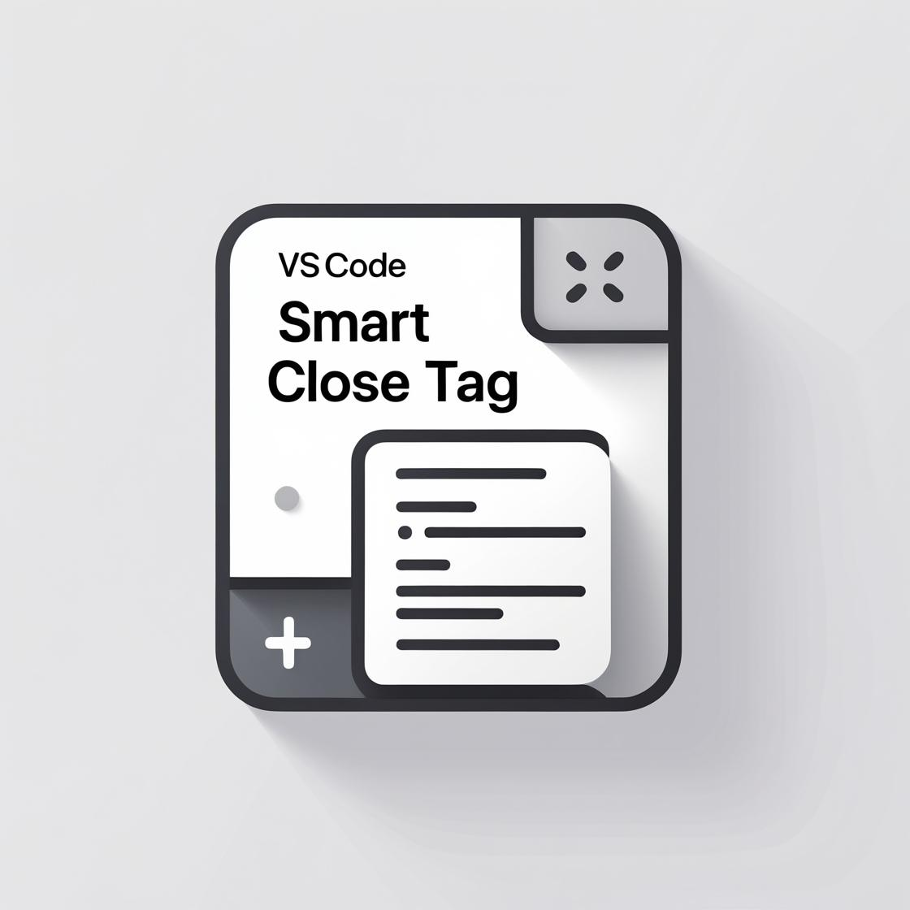

<p align="center">
  
</p>

<h1 align="center">Smart Close Tag (Bản Tiếng Việt)</h1>

<p align="center">
  <strong>Extension tự động hoàn thành cặp thẻ siêu tốc, thông minh và xịn xò bậc nhất dành cho Visual Studio Code.</strong><br>
  Hoạt động trên <em>MỌI</em> loại file không giới hạn: HTML, XML, XAML, AXAML, JSX, TSX, Vue, Svelte, PHP, Blade, Astro, Markdown, v.v.!
</p>

<p align="center">
  <a href="https://marketplace.visualstudio.com/items?itemName=NguyenTungSk2004.smart-close-tag"></a>
  <a href="https://marketplace.visualstudio.com/items?itemName=NguyenTungSk2004.smart-close-tag"></a>
  <a href="https://marketplace.visualstudio.com/items?itemName=NguyenTungSk2004.smart-close-tag"></a>
  <a href="https://github.com/NguyenTungSk2004/smart-close-tag/blob/main/LICENSE"></a>
</p>

<p align="center">
  <a href="README.md"><strong>English</strong></a> • 
  <a href="README.vn.md"><strong>Tiếng Việt</strong></a>
</p>

---

## 🌟 Tại Sao Nên Chọn Smart Close Tag?

Các extension tự đóng thẻ truyền thống thường chỉ hoạt động với file HTML/XML tiêu chuẩn và bắt buộc bạn phải gõ đầy đủ dấu `<tag>`. **Smart Close Tag** nâng tầm hiệu suất lập trình của bạn với khả năng **hỗ trợ mọi loại file**, cú pháp gõ tắt bằng dấu gạch chéo `/`, tự nhận diện thuộc tính, phân biệt thẻ tự đóng và bọc thẻ tức thì.

Bất kể bạn viết **React (JSX/TSX)**, **Vue**, **Svelte**, **XAML/AXAML**, **PHP/Blade**, **Astro**, **XML** hay template riêng, Smart Close Tag đều nhận diện và hoạt động mượt mà ngay khi cài đặt!

---

## 🚀 Tóm Tắt Tính Năng

| Cú pháp / Phím tắt | Thao tác | Kết quả (`|` là vị trí con trỏ) |
| :--- | :--- | :--- |
| `div/` + `Tab` / `Enter` | Viết tắt thẻ đơn | `<div>\|</div>` |
| `button class="btn btn-primary" id="sub"/` + `Tab` | Viết tắt thẻ có thuộc tính | `<button class="btn btn-primary" id="sub">\|</button>` |
| `img/` + `Tab` / `Enter` | Thẻ tự đóng (Void Element) | `\|` |
| `Component//` + `Tab` / `Enter` | Ép thẻ tự đóng với double slash | `<Component />\|` |
| `<section>` (gõ `>`) | Tự đóng thẻ mở theo thời gian thực | `<section>\|</section>` |
| `</` (gõ `</`) | Tự quét và hoàn tất thẻ đóng | Tự động điền nốt tên thẻ mở gần nhất `</tag>` |
| `Alt + W` (hoặc `Option + W`) | Bọc vùng chọn trong thẻ (Wrap) | Bọc đoạn code/văn bản đang bôi đen vào thẻ |

---

## 💡 Chi Tiết Các Tính Năng Đỉnh Cao

### 1. Hỗ Trợ Mọi Loại File (Không Giới Hạn)
Smart Close Tag **không bị bó buộc** trong HTML hay XML. Extension kích hoạt trên mọi định dạng:
- **Frontend Hiện Đại**: HTML5, React JSX, React TSX, Vue (`.vue`), Svelte, Astro, Angular templates
- **Mobile & Desktop**: XAML (.xaml), Avalonia XAML (.axaml), MAUI, WPF
- **Backend & Template Engines**: PHP, Blade (.blade.php), Twig, Liquid, ERB, Smarty, ASP.NET
- **Dữ Liệu & Tài Liệu**: XML, SVG, MathML, RSS, Markdown (.md), và cả các file mới chưa lưu (`untitled`)!

### 2. Mở Rộng Thẻ Siêu Tốc (`TagName/`)
Chỉ cần gõ tên thẻ kèm dấu `/`, sau đó nhấn `Tab` hoặc `Enter`:
```html
div/               → <div>|</div>
Grid.Row/          → <Grid.Row>|</Grid.Row>
local:UserCard/    → <local:UserCard>|</local:UserCard>
custom-element/    → <custom-element>|</custom-element>
```

### 3. Thông Minh Với Thuộc Tính (Attributes)
Bạn muốn thêm thuộc tính ngay khi mở thẻ? Cứ gõ tự nhiên trước dấu `/`:
```html
div class="container mx-auto" id="app"/
→ <div class="container mx-auto" id="app">|</div>

input type="email" required placeholder="nhap@email.com"/
→ <input type="email" required placeholder="nhap@email.com" />
```

### 4. Tự Động Nhận Diện Thẻ Tự Đóng (`TagName//` & Void Elements)
- **Nhận diện thẻ HTML rỗng**: Các thẻ như `img`, `input`, `br`, `hr`, `meta`, `link`... sẽ tự sinh dạng `` chuẩn mực thay vì sinh cặp thẻ thừa thãi.
- **Cú pháp hai dấu gạch chéo `//`**: Với bất kỳ Component React/Vue nào, chỉ cần gõ `//` ở cuối:
```jsx
Avatar src={user.photo}//  → <Avatar src={user.photo} />
```

### 5. Tự Động Đóng Thẻ Khi Gõ `>` và `</`
- Khi gõ `>` sau `<MyComponent>`, extension tự động chèn `</MyComponent>` và đặt con trỏ ở giữa.
- Khi gõ `</`, extension quét ngược tài liệu để tìm thẻ mở gần nhất chưa đóng và điền nốt.

### 6. Bọc Đoạn Mã Đang Chọn Bằng Thẻ (`Alt + W`)
1. Bôi đen đoạn mã hoặc dòng chữ bất kỳ.
2. Nhấn `Alt + W` (Windows/Linux) hoặc `Option + W` (macOS).
3. Nhập thẻ bạn muốn bọc (ví dụ: `div class="card"` hoặc `ScrollView`).
4. Nhấn `Enter` — đoạn mã được bọc ngay ngắn với thụt lề (indent) chuẩn xác!

### 7. Thanh Trạng Thái Gọn Gàng & Menu Tác Vụ Nhanh
Biểu tượng `$(tag) Smart Tag: On` nằm ở thanh trạng thái phía dưới. Bấm vào biểu tượng để bật/tắt nhanh, mở cài đặt hoặc chạy lệnh bọc thẻ mà không cần nhớ phím tắt.

---

## ⚙️ Cài Đặt & Cấu Hình

Vào **File > Preferences > Settings** (hoặc nhấn `Ctrl+,` và tìm `smartCloseTag`):

| Tên Cài Đặt | Kiểu | Mặc Định | Mô Tả |
| :--- | :--- | :--- | :--- |
| `smartCloseTag.enable` | `boolean` | `true` | Bật hoặc tắt toàn bộ tính năng của Smart Close Tag. |
| `smartCloseTag.enableForAllFiles` | `boolean` | `true` | Cho phép Smart Close Tag chạy trên mọi loại file (`*`). |
| `smartCloseTag.includedLanguages` | `array` | `["*"]` | Danh sách ngôn ngữ được kích hoạt (hỗ trợ ký tự đại diện `*`). |
| `smartCloseTag.excludedLanguages` | `array` | `[]` | Danh sách ngôn ngữ bị loại trừ (ví dụ `["plaintext"]`). |
| `smartCloseTag.enableAttributesSupport` | `boolean` | `true` | Cho phép gõ thuộc tính trước dấu `/` (ví dụ `div class="box"/`). |
| `smartCloseTag.enableAutoCloseOnGreaterThan` | `boolean` | `true` | Tự động chèn thẻ đóng khi gõ `>`. |
| `smartCloseTag.enableAutoCloseOnSlash` | `boolean` | `true` | Tự động hoàn tất thẻ đóng khi gõ `</`. |
| `smartCloseTag.selfClosingFormat` | `string` | `"slash"` | Định dạng thẻ tự đóng: `"slash"` (``) hoặc `"void"` (``). |
| `smartCloseTag.selfClosingTags` | `array` | `[]` | Danh sách các tên thẻ tùy biến bổ sung coi là thẻ tự đóng. |
| `smartCloseTag.showStatusBarItem` | `boolean` | `true` | Hiển thị biểu tượng Smart Close Tag trên thanh trạng thái. |

---

## ⌨️ Phím Tắt Tiện Dụng

| Phím Tắt | Lệnh | Khi Nào Sử Dụng |
| :--- | :--- | :--- |
| `Alt + W` (Win/Linux) / `Option + W` (Mac) | `smartCloseTag.wrapWithTag` | Khi đang bôi đen đoạn mã trong editor |
| `Tab` hoặc `Enter` | Chấp nhận gợi ý snippet | Khi gợi ý tạo thẻ xuất hiện |

---

## 📦 Cách Cài Đặt

### Cách 1: Cài đặt trực tiếp từ Visual Studio Marketplace (Khuyên dùng)
<p>
  <a href="https://marketplace.visualstudio.com/items?itemName=NguyenTungSk2004.smart-close-tag">
    
  </a>
</p>

1. Mở **Visual Studio Code**.
2. Nhấn tổ hợp phím `Ctrl + Shift + X` (hoặc `Cmd + Shift + X` trên Mac) để mở Extensions.
3. Tìm kiếm từ khóa `Smart Close Tag` (hoặc `NguyenTungSk2004.smart-close-tag`).
4. Bấm **Install** (Cài đặt).

### Cách 2: Cài nhanh qua Quick Open
Nhấn `Ctrl + P` (hoặc `Cmd + P` trên Mac) và dán lệnh:
```bash
ext install NguyenTungSk2004.smart-close-tag
```

### Cách 3: Cài qua Terminal / Command Line
```bash
code --install-extension NguyenTungSk2004.smart-close-tag
```

---

## ⭐ Đánh Giá & Ủng Hộ Dự Án

Nếu **Smart Close Tag** giúp ích cho công việc hàng ngày của bạn, đừng quên dành tặng dự án **[5 sao đánh giá trên VS Code Marketplace](https://marketplace.visualstudio.com/items?itemName=NguyenTungSk2004.smart-close-tag&ssr=false#review-details)** và tặng 1 ⭐ Star trên [GitHub Repository](https://github.com/NguyenTungSk2004/smart-close-tag) nhé! Sự ủng hộ của bạn là động lực rất lớn cho tác giả.

---

## 🤝 Đóng Góp Phát Triển

Mọi ý kiến đóng góp, báo lỗi (issue) và pull request đều được trân trọng!
- GitHub: [https://github.com/NguyenTungSk2004/smart-close-tag](https://github.com/NguyenTungSk2004/smart-close-tag)
- Báo lỗi: [Issue Tracker](https://github.com/NguyenTungSk2004/smart-close-tag/issues)

---

## 📄 Giấy Phép

Phát hành theo giấy phép [MIT License](LICENSE).

Được phát triển với tất cả tâm huyết bởi [NguyenTungSk2004](https://github.com/NguyenTungSk2004).
